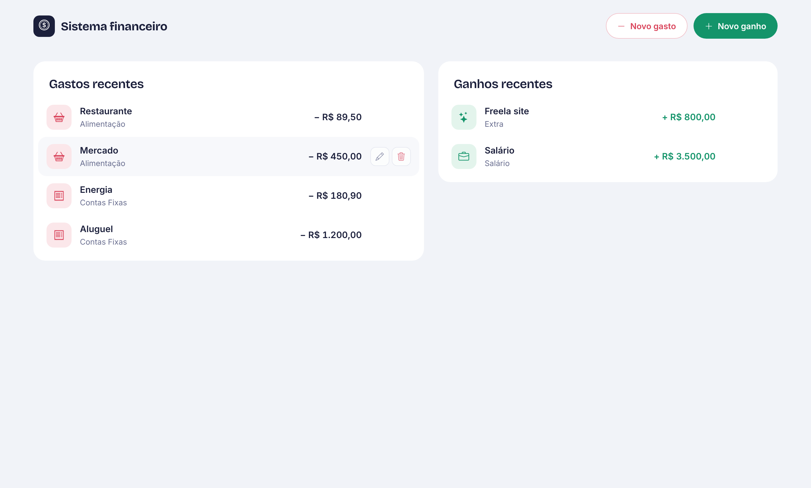
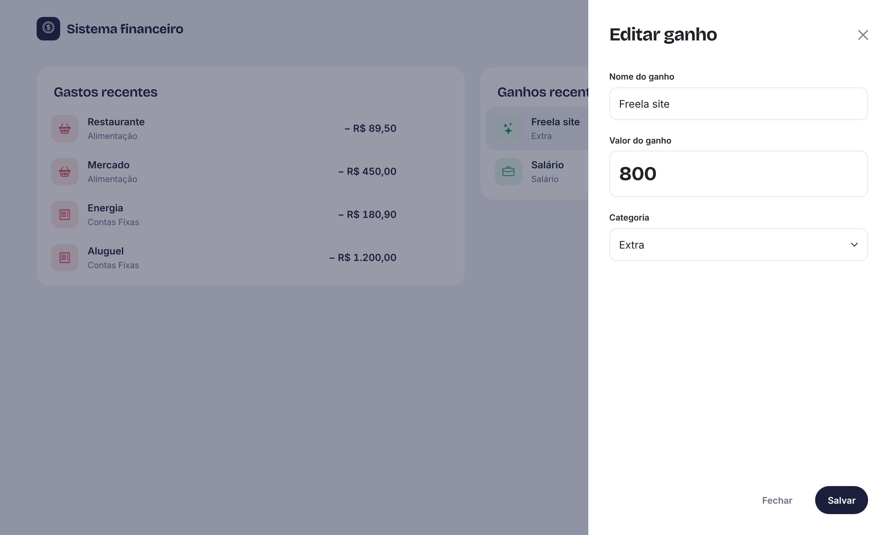
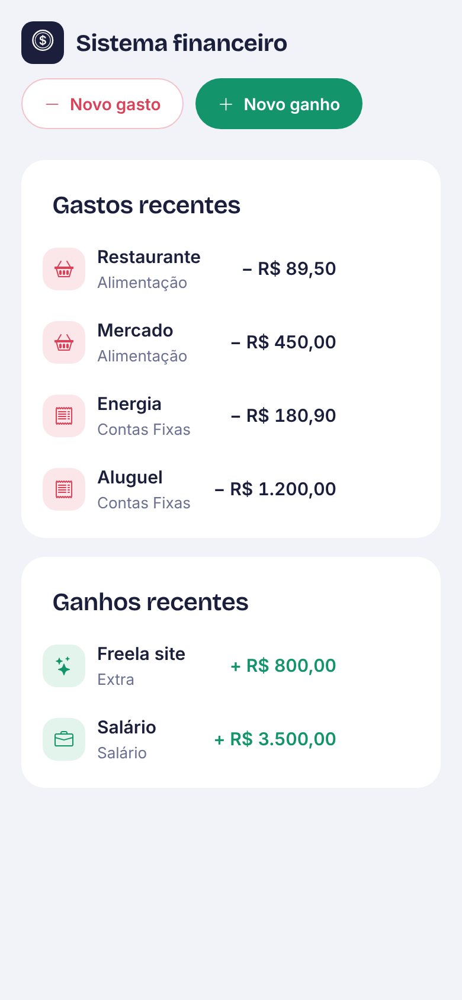

# Sistema Financeiro

Aplicação web para registrar e acompanhar **gastos** e **ganhos** pessoais. Desenvolvida em React como projeto de estudo, com foco em componentização, custom hooks e boas práticas de versionamento.



## Funcionalidades

- Cadastrar gastos e ganhos com nome, valor e categoria
- Listar as 5 transações mais recentes de cada tipo
- Editar e excluir transações
- Valores formatados em reais (R$) e ícone por categoria
- Layout responsivo para desktop e celular

| Edição de uma transação | Versão mobile |
|---|---|
|  |  |

## Tecnologias

- [React 19](https://react.dev) com [Vite](https://vite.dev)
- [Bootstrap 5](https://getbootstrap.com) e [Bootstrap Icons](https://icons.getbootstrap.com)
- [json-server](https://github.com/typicode/json-server) como API REST simulada
- [oxlint](https://oxc.rs) para análise estática do código

## Como rodar

**Pré-requisito:** [Node.js](https://nodejs.org) instalado.

```bash
# 1. Clone o repositório
git clone https://github.com/Moreira-Leandro/FinanceiroReact.git
cd FinanceiroReact

# 2. Instale as dependências
npm install

# 3. Em um terminal, suba a API (porta 3001)
npm run api

# 4. Em outro terminal, rode o front-end
npm run dev
```

Depois, abra o endereço exibido pelo Vite (normalmente `http://localhost:5173`).

Os dados ficam salvos no arquivo `db.json`.

## Scripts

| Comando | O que faz |
|---|---|
| `npm run dev` | Inicia o front-end em modo de desenvolvimento |
| `npm run api` | Inicia a API com json-server na porta 3001 |
| `npm run build` | Gera a versão de produção na pasta `dist` |
| `npm run preview` | Serve localmente a versão de produção |
| `npm run lint` | Analisa o código com oxlint |

## Estrutura do projeto

```
src/
├── components/
│   ├── dashboard/Dashboard.jsx   # Cards com as listas de gastos e ganhos
│   ├── nav-bar/NavBar.jsx        # Barra superior com as ações de cadastro
│   ├── Modal.jsx                 # Modal genérico (header, body e footer)
│   ├── TransacaoModal.jsx        # Decide se o modal mostra cadastro ou edição
│   ├── TransacaoForm.jsx         # Formulário de transação
│   └── TransacaoLista.jsx        # Lista de transações
├── constants/tipos.js            # Tipos de transação, categorias e títulos
├── hooks/useTransacao.js         # Estado e operações de cada tipo de transação
├── service/transacaoService.js   # Comunicação com a API
├── styles/                       # Estilos globais e da tela inicial
├── App.jsx
└── main.jsx
```

## Arquitetura

O código é dividido em camadas, cada uma com uma responsabilidade:

- **Service** (`transacaoService.js`): faz as requisições HTTP para a API (listar, adicionar, atualizar e remover).
- **Hook** (`useTransacao`): guarda a lista de um tipo de transação e expõe as operações sobre ela. O `App` usa uma instância para gastos e outra para ganhos.
- **Componentes**: só cuidam da interface. Recebem dados e callbacks por props e não acessam a API diretamente.
- **App**: coordena o estado da tela (qual modal está aberto e qual item está sendo editado).

## Fluxo de desenvolvimento

- Cada funcionalidade é desenvolvida em uma branch própria (`feature/`, `fix/`, `refactor/`, `chore/`) e integrada à `main` por pull request.
- As mensagens de commit seguem o padrão [Conventional Commits](https://www.conventionalcommits.org/pt-br/).

## Autor

Feito por [Leandro Moreira](https://github.com/Moreira-Leandro).
